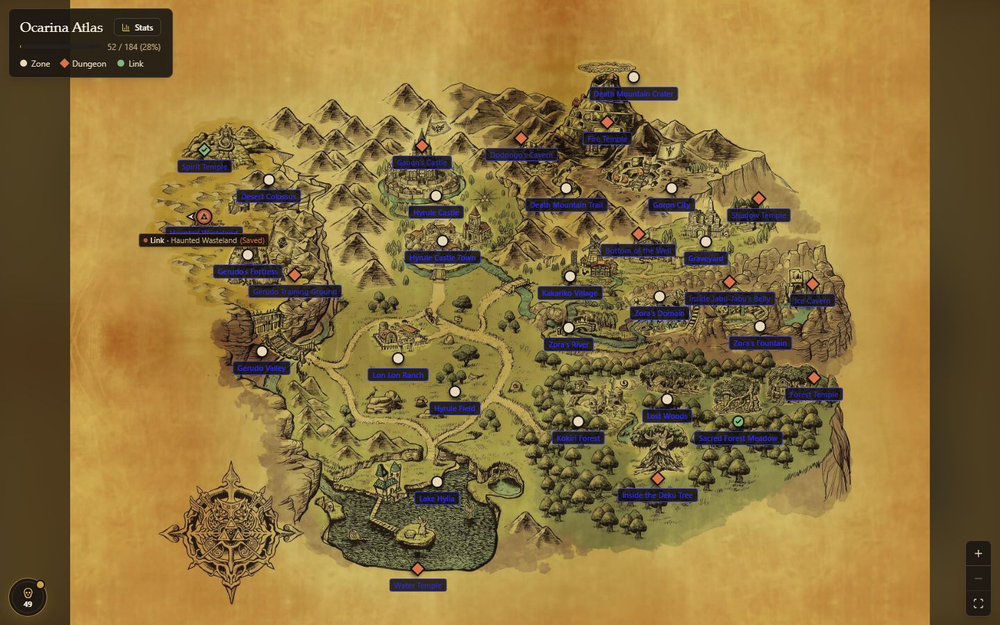
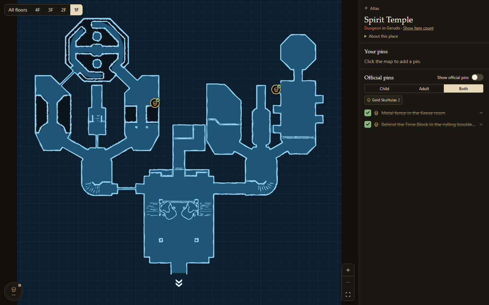

<div align="center">


# Ocarina Atlas

Interactive Hyrule field atlas and dungeon floor tracker for *The Legend of Zelda: Ocarina of Time* Remake (`0400486024DEC000`),<br>featuring live [Lichii](https://github.com/zortos293/Lichii) &amp; Fritchii memory telemetry, 100% (184/184) automatic collectible tracking, and a portable Windows launcher.

[](https://github.com/antonioalvromero/Ocarina-Atlas/releases)
[](LICENSE)

</div>

> [!CAUTION]
> Official builds of **Ocarina Atlas** are distributed **only** through [`https://github.com/antonioalvromero/Ocarina-Atlas/releases`](https://github.com/antonioalvromero/Ocarina-Atlas/releases).
> No game ROMs, decryption keys, firmware, NAND dumps, or save files are included or distributed in this repository or its releases.

---

## Downloads & Windows Quick Start (Plug & Play)

Run the live tracker on Windows without installing Node.js or editing code:

1. **Download & Extract**
   - Download `OcarinaAtlas-Windows-x64.zip` from **[GitHub Releases](https://github.com/antonioalvromero/Ocarina-Atlas/releases)**.
   - Right-click the archive, select **Extract All...**, and extract the `OcarinaAtlas-Windows-x64` folder anywhere (for example, `Desktop` or `Documents`).

2. **Launch `OcarinaAtlas.exe`**
   - Open the extracted folder and double-click **`OcarinaAtlas.exe`**.
   - *(If Windows SmartScreen shows "Windows protected your PC" for an unsigned open-source binary, click **More info** -> **Run anyway**.)*

3. **Emulator Live Sync (Lichii / Fritchii)**
   - **Recommended (1-Click Setup):** In the main control card, click **1-Click Setup Sync** (shown as **Configured ↻** once active so you can re-apply anytime).
     - This creates or updates `nx2_switches.txt` in your detected emulator profile folder(s) (`%APPDATA%\fritchii\nx2_switches.txt` and/or `%APPDATA%\lichii\nx2_switches.txt`) with `EDEN_NX2_DEBUG_SERVER=127.0.0.1:6545` while preserving your existing switches.
     - **If Lichii or Fritchii is already running, close and restart it completely** so it loads the debug server on startup.
   - **Manual Fallback:**
     1. Press `Win + R`, paste `%APPDATA%\fritchii` (for Fritchii) or `%APPDATA%\lichii` (for Lichii), and press **Enter** (create the folder if it does not exist).
     2. Create or edit `nx2_switches.txt` inside that folder and add:
        ```text
        EDEN_NX2_DEBUG_SERVER=127.0.0.1:6545
        ```
     3. Save the file and restart `lichii.exe` / `fritchii.exe`.

4. **Start Map**
   - Click **Start Map** in `OcarinaAtlas.exe`.
   - Your default browser opens `http://127.0.0.1:3000` automatically when **Auto-open browser** is enabled in **Settings** (or click **Open Map**).

5. **Second Screen (LAN, Optional)**
   - Ensure your PC and second-screen device (iPad, tablet, phone, or another PC) are on the **same local Wi-Fi or Ethernet network** with Windows set to a **Private** network profile.
   - In the **Second Screen (LAN)** card, click **Allow LAN Access** once and approve the Administrator prompt if your tablet cannot reach the page yet (creates an inbound Windows Defender Firewall rule scoped strictly to **Private** networks).
   - If your PC has multiple active networks (such as Ethernet + Mesh Wi-Fi), choose the matching adapter from the LAN URL selector, click **Copy URL** or **QR Code** to scan from a phone/tablet, and open that `http://` address in your browser. *(Live Link coordinates, collectibles, and pins sync automatically across devices.)*

6. **Play in Lichii or Fritchii**
   - Boot *Ocarina of Time* Remake (`0400486024DEC000`) in Lichii or Fritchii and load a save slot.
   - Confirm the launcher telemetry strip shows your live scene/age/Skulltula count and the bottom-left Gold Skulltula medallion pulses green. Hover (or tap on touch devices) over the medallion to expand the tracker card.

### Connection States

| Map Tracker Status | Launcher Status | Meaning |
| --- | --- | --- |
| **Lichii · Live** (pulsing green) | **Emulator: Live** | Connected to Lichii or Fritchii `:6545` and streaming live RAM coordinates, floor, and 184/184 collectible flags. |
| **Waiting for game** (amber) | **Emulator: Waiting** | Emulator RPC `:6545` is open, but Link is not in an active gameplay scene yet (title/boot screen). Displays save fallback data if available. |
| **Save only** (static amber) | **Emulator: Closed** | RPC `:6545` is unreachable; displaying the latest local `caption.sav` / `progress.sav` snapshot (`(Saved)`). Live movement and Auto Tracking are paused. |
| **Disconnected** (muted) | **Emulator: Closed** | Neither emulator RPC `:6545` nor a local save directory was found (or the local server stopped). Click **Retry** once ready. |

<details>
<summary>Launcher CLI Flags &amp; Environment Variables</summary>

#### Optional Command-Line Flags (`OcarinaAtlas.exe` / `scripts/server-entry.ts`)
- `--port <number>` (or `--port=<number>`) — Override web UI port (`1..65535`)
- `--lan` — Bind all local network interfaces (`0.0.0.0`, default) for tablet/iPad/LAN browser access
- `--local-only` / `--localhost` — Restrict the web server strictly to `127.0.0.1`
- `--host <address>` — Bind a specific local interface IP or hostname
- `--lichii-host <host>` — Override Lichii RPC host (`OcarinaAtlas.exe`)
- `--lichii-port <number>` — Override Lichii RPC port (`OcarinaAtlas.exe`)
- `--no-browser` — Do not open a browser tab on startup (`OcarinaAtlas.exe`)
- `--minimized` — Start minimized (`OcarinaAtlas.exe`)
- `--auto-start` — Start the map server immediately on launch (`OcarinaAtlas.exe`)

#### Environment Variables (`scripts/server-entry.ts` &amp; `src/lib/lichii-server.ts`)
| Variable | Default | Description |
| --- | --- | --- |
| `HOST` | `0.0.0.0` | Bind address for the standalone HTTP server. Set to `127.0.0.1` to restrict access to localhost only. |
| `PORT` | `3000` | HTTP port for the standalone server (`0..65535`). |
| `APP_DIST_DIR` | Auto-resolved `dist` | Explicit path to the built `dist/` folder (`client/` + `server/`) when running `standalone-server.mjs`. |
| `LICHII_HOST` | `127.0.0.1` | Hostname or IP of the Lichii JSON-RPC debug server. |
| `LICHII_PORT` | `6545` | TCP port of the Lichii JSON-RPC debug server (`1..65535`). |
| `LICHII_SAVE_DIR` | `%APPDATA%\fritchii\nand\user\save\0000000000000000` / `%APPDATA%\lichii\nand\user\save\0000000000000000` | Optional save folder override. Supports direct `slot_*`, title ID (`0400486024DEC000`), profile, or `nand/user/save` layouts. |

</details>

---

## Preview

| Hyrule World Map & Global Progress | Dungeon Floor & Skulltula Tracker |
| --- | --- |
|  |  |

---

## Features

### Live Emulator Telemetry (Lichii & Fritchii)
- **Real-Time `PlayerPin`:** Displays Link's live position, compass heading cone (`yaw`), current floor badge (`1F`–`5F`, `B1`–`B4`), and 3D `(X, Y, Z)` hover coordinates across the Hyrule World Map, zone/dungeon maps, and All-Floors grid view.
- **ASLR-Safe `MOD0` Reader:** Dynamically resolves the Switch `MOD0` main NSO base and `.bss` singletons over Lichii / Fritchii JSON-RPC (`127.0.0.1:6545`), recovering cleanly across emulator restarts.
- **100% Automatic Collectible Tracking (`184 / 184`):** Reads exact collected actor ID hashes (`masterTable` / `0xa3db7114`), `PouchData.Item_Token_Gold.StockNum`, and live `GameDataMgr` `Bool` / `Int` flags in RAM to mark, reveal, and reconcile all 7 categories automatically (100 Gold Skulltulas, 36 Pieces of Heart, 8 Heart Containers, 10 Magic Beans, 6 Great Fairies, 5 Bottles, and 19 Fairy Thoughts), including unmarking items when reloading an earlier save and showing pickup toast notifications.
- **Follow Link & Camera Follow:** Toggle **Follow Link** to switch zones and dungeon floors automatically as Link moves and keep Link centered on screen even when zoomed in (pauses briefly while dragging manually), or click **Go to Link** anytime.
- **Read-Only Save Fallback:** When RPC `:6545` is closed, reads the newest local save slot (`caption.sav` / `progress.sav`) in read-only mode and labels the state **Save only** (`(Saved)`).

### Interactive Map & Progress Tracker
- **Complete Atlas Dataset:** 32 places (20 overworld zones and 12 dungeons) and 184 official collectibles across 7 categories (Gold Skulltulas, Pieces of Heart, Heart Containers, Magic Beans, Great Fairies, Bottles, and Fairy Thoughts).
- **Global Progress Stats & Interactive Categories:** Open the **Stats** drawer from the World Map to view overall completion (`X / 184`), click any category card to filter `Remaining` or `All` items, and click an item to jump directly to its zone, floor, and pin.
- **Mobile & Tablet Fullscreen / Landscape Mode:** Use the **Fullscreen** (`Exit fullscreen`) toggle on the World Map or any zone/dungeon view to hide the header and sidebar for a dedicated map-only canvas, enjoy a landscape-optimized layout on phones and tablets, and tap any pin to open a floating info popover that dismisses automatically when tapping outside.
- **Custom Pins & Smart Merge:** Drop typed custom pins anywhere on a map; placing a pin near a matching official pin merges and reveals it automatically.
- **Age & Category Filtering:** Filter by **Child**, **Adult**, or **Both**, hide completed categories, inspect **All floors** side-by-side, and persist per-map zoom/pan state in `localStorage` (`oot-map:v1:*`).
- **Offline PWA Support:** Built with a service worker (`sw.js`) and web manifest so maps and visited item media cache locally.

### Portable Windows Launcher (`OcarinaAtlas.exe`)
- **Self-Contained Runtime:** Bundles portable `runtime/node.exe`, `app/standalone-server.mjs`, and `app/dist/` with zero Node.js or `npm` installation required.
- **Auto-Updater (`UpdateDialog`):** Checks GitHub Releases for newer versions and lets you download and install updates directly from the launcher.
- **LAN Adapter Ranking:** Filters out VPNs and virtual NICs, lets you pick between multiple active physical adapters, and copies the exact second-screen URL in one click.
- **Clean Lifecycle Management:** Supervises the Node child process via a Windows Job Object (`JOB_OBJECT_LIMIT_KILL_ON_JOB_CLOSE`) so closing the launcher never leaves orphan processes on port `3000`.

---

## Compatibility & Issue Reporting

- **Windows 10 / 11 (x64):** Required for `OcarinaAtlas.exe` and live Lichii & Fritchii emulator telemetry.
- **Supported Game Build:** *The Legend of Zelda: Ocarina of Time* Remake (`0400486024DEC000`).
- **Web-Only (Linux / macOS / Docker):** The interactive web map UI runs on any OS via Node.js or the included [`Dockerfile`](Dockerfile) (`oven/bun:1.4`) without Windows emulator features.
- **Reporting Bugs:** Open an issue with your **Ocarina Atlas** release version, emulator version (Lichii / Fritchii), and relevant output copied from the **`Logs`** drawer in `OcarinaAtlas.exe`. Please **never** attach ROMs, decryption keys, NAND dumps, or personal save archives.

---

## Building from Source

### Prerequisites
- **Node.js `22.12+` or `24.x`** and **npm** (or **Bun**, matching `bun.lock`)
- **Windows 10 / 11 (x64)** with **.NET Framework 4.x** (`%WINDIR%\Microsoft.NET\Framework64\v4*\csc.exe`, preinstalled on Windows) to compile `OcarinaAtlas.exe`

### Commands

```sh
npm install           # or `bun install`
npm run dev           # Vite dev server at http://localhost:3000 with /api/lichii/state
npm run typecheck     # TypeScript typechecking (tsc --noEmit)
npm test              # Vitest unit tests (src/**/*.test.ts)
npm run build         # Vite client + standalone SSR bundle (dist/)
npm run start         # Preview the production Vite build
npm run server:build  # Bundle zero-node_modules server (dist/standalone-server.mjs)
npm run build:win     # Build portable Windows bundle + release/OcarinaAtlas-Windows-x64.zip
```

<details>
<summary>Architecture &amp; Repository Layout</summary>

```text
Lichii / Fritchii Emulator (:6545) / Local Save Slots (Read-Only Fallback)
        │
        ▼
Telemetry Bridge (src/lib/lichii-server.ts)
  • Discovers Switch MOD0 base -> .bss singletons -> Sub[36], GDM, flags
  • Maps 32 scenes + floor thresholds + 184/184 collectible flags (masterTable + GameDataMgr)
  • Exposes /api/lichii/stream (120 ms shared SSE broadcaster) & GET /api/lichii/state
        │  SSE stream (120 ms) + HTTP fallback (150 ms live / 750 ms idle)
        ▼
React / TanStack Start UI (src/lib/useLichiiTracker.ts + src/components/*)
        ▲  Supervised via Windows Job Object
Windows Launcher (launcher/OcarinaAtlas.cs -> OcarinaAtlas.exe)
```

| Path | Purpose |
| --- | --- |
| `src/routes/` | TanStack Start routes (`__root.tsx`, `index.tsx`, `$zone.tsx`). |
| `src/components/` | `MapViewport.tsx` (zoom/pan + Camera Follow), `WorldMap.tsx`, `PlaceView.tsx`, `FloorGrid.tsx`, `GlobalStatsDrawer.tsx`, `PlayerPin.tsx`, and `LichiiStatusPanel.tsx`. |
| `src/lib/` | Dataset helpers (`data.ts`), projection math (`coords.ts`), pin merging (`merge.ts`), `localStorage` persistence (`storage.ts`), Lichii telemetry (`lichii-server.ts`, `lichii-types.ts`), client polling (`useLichiiTracker.ts`), and `*.test.ts` Vitest suites. |
| `src/data/oot.json` | Atlas dataset (32 places, 184 official items, categories, requirements). |
| `launcher/` | Native C# WinForms Windows launcher source (`OcarinaAtlas.cs`) and icon (`OcarinaAtlas.ico`). |
| `scripts/` | Standalone Node HTTP server (`server-entry.ts`), Windows packager (`build-win.mjs`), smoke test (`smoke-test-win.ps1`), and release notes generator (`generate-release-notes.mjs`). |
| `.github/` | CI (`ci.yml`), Windows release workflow (`release-windows.yml`), templates, and release config. |
| `AGENTS.md` | Architecture notes, engineering invariants, and verification checklist for AI coding agents. |

</details>

See [`CONTRIBUTING.md`](CONTRIBUTING.md), [`CODE_OF_CONDUCT.md`](CODE_OF_CONDUCT.md), [`SECURITY.md`](SECURITY.md), and [`AGENTS.md`](AGENTS.md) before opening a pull request.

---

## Credits

- **Original Map Tracker:** Built upon [`lucasriondel/oot-remake-map`](https://github.com/lucasriondel/oot-remake-map) (Field Atlas).
- **Emulator Integration:** Built for [`zortos293/Lichii`](https://github.com/zortos293/Lichii) and [`Frizti/Fritchii`](https://github.com/Frizti/Fritchii).
- **Map Assets & Item Data:** Map images and location data originate from [Nintendúo](https://nintenduo.com/juegos/the-legend-of-zelda-ocarina-of-time/mapa/en/) and belong to their respective owner.
- **Documentation Co-Authorship:** Repository documentation was co-authored with **Antigravity AI** (Google DeepMind).
- **Disclaimer:** Non-commercial fan project, not affiliated with Nintendo.

---

## License

Newly authored **Ocarina Atlas** components — including the live Lichii telemetry bridge (`src/lib/lichii-*`, `src/lib/useLichiiTracker.ts`, `src/components/LichiiStatusPanel.tsx`, `src/components/PlayerPin.tsx`), Windows launcher (`launcher/`), build and release automation scripts (`scripts/`, `.github/`), and documentation — are licensed under the **[MIT License](LICENSE)**.

The upstream repository ([`lucasriondel/oot-remake-map`](https://github.com/lucasriondel/oot-remake-map)) does **not** include a `LICENSE` file in its root directory; upstream base code remains subject to its upstream terms, and map assets/game IP remain the property of their respective owners.
